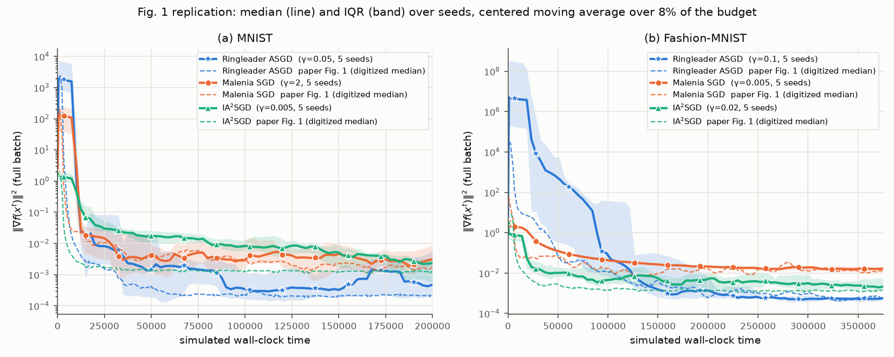
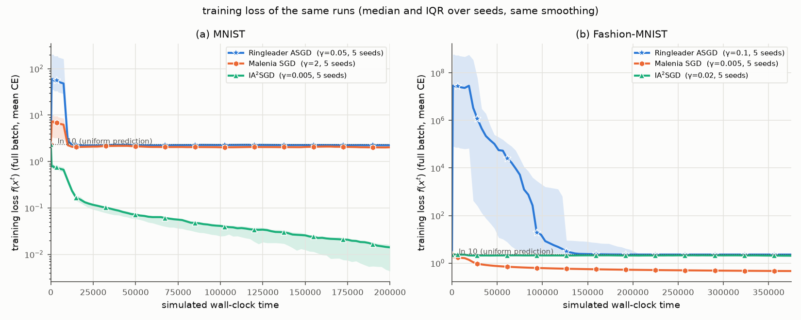
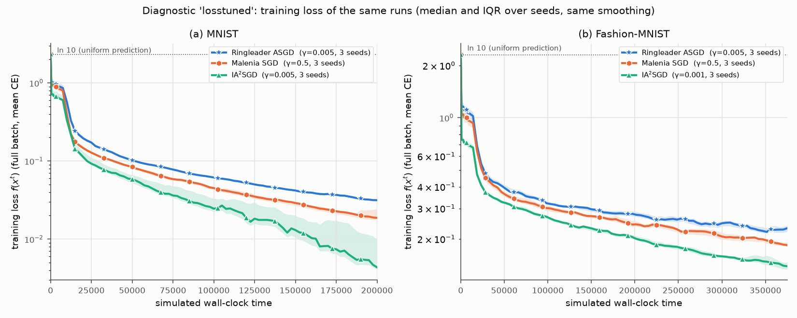

# Replication: Ringleader ASGD (Maranjyan & Richtárik, ICLR 2026)

*"Ringleader ASGD: The First Asynchronous SGD with Optimal Time Complexity under Data Heterogeneity"*,
A. Maranjyan, P. Richtárik, ICLR 2026
([proceedings](https://proceedings.iclr.cc/paper_files/paper/2026/hash/08d70284b013c03ba89cd2b642bc864b-Abstract-Conference.html),
[arXiv:2509.22860](https://arxiv.org/abs/2509.22860)).

**Version used:** the ICLR 2026 camera-ready PDF (31 pages, experiments in **Appendix A**, Fig. 1).
arXiv v3 (19 Feb 2026, 35 pages) has the same experiment as Section 6 with word-for-word identical setup
text and an identical Fig. 1, so the two versions do not differ for this replication. I found no
official code: no repository is linked from the paper, arXiv or the first author's homepage.

## TL;DR

| Experiment | Paper claim | Our result (5 seeds, tuned on the paper's grid) | Status |
|---|---|---|---|
| **Fig. 1a, MNIST** (n = 100, Dirichlet 0.1, MLP 784-128-10) | With tuned γ, Ringleader ASGD reaches a lower ‖∇f‖² faster than Malenia SGD and IA²SGD. End values ≈ 2.1e-4 (Ringleader), 1.6e-3 (Malenia), 1.2e-3 (IA²SGD) | Same ordering. Ringleader has the lowest median from t ≈ 40k on. Tail medians are 5.1e-4 / 3.2e-3 / 2.5e-3, each ≈ 0.3–0.4 decades above the paper. Ringleader beats Malenia in 4/5 seeds and IA²SGD in 3/5. The ordering also holds with a second tuning criterion (§4.2) | **Replicated in the paper's metric** — but see the caveat below |
| **Fig. 1b, Fashion-MNIST** | Same claim. End values ≈ 5.9e-4 / 1.3e-2 / 1.4e-3; IA²SGD stays below Ringleader until t ≈ 200k | Same ordering. Tail medians are 4.4e-4 / 1.5e-2 / 2.9e-3. Ringleader beats both baselines in 5/5 seeds and drops below IA²SGD at t ≈ 130k. With the second tuning criterion IA²SGD ends lowest | **Replicated in the paper's metric, sensitive to the tuning rule** |
| Underlying claim that Ringleader *trains faster* | – | **Not supported here.** The stepsizes that win on ‖∇f‖² make the network **collapse**: an early blow-up, then a plateau at training loss ≈ ln 10 with chance-level accuracy, where the gradient is tiny (on MNIST, 80 % of the hidden ReLUs end up dead). All five tuned Ringleader runs end with loss 2.10–2.30 on both datasets; IA²SGD on MNIST ends at 0.013. Retuned on training loss (§4.4), Ringleader is the **slowest of the three on both datasets**. Training loss over the last 10 % of the budget (median of 3 seeds) is 0.032 for Ringleader vs 0.020 for Malenia vs 0.005 for IA²SGD on MNIST, and 0.23 vs 0.20 vs 0.15 on FMNIST | **Not replicated** (metric artefact; the paper reports no loss or accuracy, so we cannot tell if its own runs collapsed — the large early spikes in its Fig. 1 suggest they may have) |



Dashed lines are the paper's medians, digitized from its Fig. 1. Bands are the IQR over 5 seeds.
Smoothing is a centered moving average over 8 % of the budget, applied after aggregation as in the paper.



The same runs, showing training loss instead of ‖∇f‖². The tuned Ringleader runs (and tuned Malenia on
MNIST, tuned IA²SGD on FMNIST) end at the ln 10 plateau (chance-level predictions).



Diagnostic C (§4.4): the same comparison, but with γ picked on the grid by **training loss** instead of
‖∇f‖² (3 seeds). Ringleader is the slowest of the three on both datasets.

## 1. What the paper reports

The paper has a single experiment (App. A, "a toy simulation"), shown in **Fig. 1** with two panels. There are
no tables of numbers.

| # | Experiment | Setup as written (App. A) | Claim |
|---|---|---|---|
| Fig. 1a | MNIST, n = 100 clients | 60k train images, standard normalization; equal-size Dirichlet(α = 0.1) label partition (rounded allocation, shortfall topped up from other classes); 2-layer MLP Linear(784,128)-ReLU-Linear(128,10), mean CE; client minibatch 4; full-batch ‖∇f(x)‖² reported; τᵢ = i + \|ηᵢ\|, ηᵢ ~ N(0, i); γ tuned per method on {0.001, 0.005, 0.01, 0.02, 0.05, 0.1, 0.2, 0.5, 1, 2} "within a fixed wall-clock budget"; 30 seeds, median and IQR, centered moving average applied after aggregation | With tuned stepsizes, **Ringleader ASGD converges faster than Malenia SGD and IA²SGD**, even though Ringleader and Malenia have the same time complexity; the reason given is that Ringleader makes n updates per round (Phase 2) where Malenia makes one synchronous update |
| Fig. 1b | Fashion-MNIST | same | same |

Values read off the paper's Fig. 1 (median curves digitized from a 600-dpi render, `tools/digitize_fig1.py` →
`results/paper/*.json`):

| panel | method | t = 0.1T | t = 0.25T | t = 0.5T | t = T | mean log10 over last 10 % |
|---|---|---|---|---|---|---|
| MNIST (T = 200k) | Ringleader | 2.2e-3 | 3.8e-4 | 2.3e-4 | 2.1e-4 | −3.66 |
| | Malenia | 9.2e-3 | 4.7e-3 | 2.7e-3 | 1.6e-3 | −2.78 |
| | IA²SGD | 1.8e-3 | 1.3e-3 | 1.2e-3 | 1.2e-3 | −2.91 |
| FMNIST (T ≈ 375k) | Ringleader | 9.9e-1 | 1.2e-2 | 1.9e-3 | 5.9e-4 | −3.23 |
| | Malenia | 6.8e-2 | 1.8e-2 | 1.2e-2 | 1.3e-2 | −1.92 |
| | IA²SGD | 2.4e-3 | 1.5e-3 | 1.3e-3 | 1.4e-3 | −2.88 |

Other things visible in the figure: all curves start at ‖∇f(x⁰)‖² ≈ 2 (MNIST) and ≈ 4 (FMNIST).
Ringleader's median shoots up to ~2e3 (MNIST) and ~3e4 (FMNIST) within the first ~2k time units
before it comes down. On FMNIST, IA²SGD is below Ringleader until t ≈ 170k–200k.

## 2. Implementation

Everything is numpy (float32) running in a discrete-event simulation of the paper's compute model: n = 100
workers, worker i needs τᵢ time units per stochastic gradient, communication takes no time, and the
simulated clock jumps from one gradient arrival to the next. The event loop and the τ-model are derived from
the simulator on branch `ringmaster-asgd` (`asyncsim/timing.py`, `methods.py`); the problem, the three methods
and the experiment driver were written for this paper.

| file | content |
|---|---|
| `rlsim/problem.py` | data loading and normalization, equal-size Dirichlet partition, MLP, minibatch and full-batch gradients |
| `rlsim/timing.py` | τᵢ = i + \|ηᵢ\|, ηᵢ ~ N(0, i): `per_job` (default) or `fixed` |
| `rlsim/methods.py` | `run_ringleader` (Alg. 1), `run_malenia` (parameter-free Malenia SGD), `run_ia2sgd` |
| `rlsim/experiment.py`, `run.py` | γ sweep, multi-seed runs (5 processes, one BLAS thread each), per-run cache in `results/raw/` (gitignored) |
| `rlsim/plotting.py` | figures and summary table |
| `tools/digitize_fig1.py` | extracts the median curves from a render of the paper's Fig. 1 |
| `tests/` | sanity checks (see below); `check_collapse.py` inspects the collapsed state (§4.3) |

Exactness and speed:

* A gradient always uses the model the worker held when it **started** the computation.
* Ringleader: within a round, a worker's table entry only averages gradients taken at one point. So Gᵢ/bᵢ is
  computed as one batched gradient over the union of its bᵢ minibatches, which gives the same estimator.
* IA²SGD's gradient depends only on the model sent to the worker and the worker's minibatch. It is therefore
  evaluated eagerly in factored form (X_Bᵀ·δ for the first layer), which lets the server model be updated in
  place.
* `tests/check_ringleader_literal.py` and `tests/check_baselines_literal.py` run all three fast simulators
  against literal line-by-line transcriptions of the algorithms, using deterministic samples:
  - same iteration counts;
  - final iterates agree to ≤ 1.4e-5 relative difference (float32 rounding);
  - Ringleader's maximum delay is exactly 2n − 2, the bound of Lemma 4.1.
* `tests/check_problem.py` checks the backprop against finite differences and checks the partition.

## 3. Assumptions for details the paper does not state

| Detail | Paper | What I used | Why / evidence |
|---|---|---|---|
| Data | "MNIST", "Fashion-MNIST" | the 60 000 **training** images of each; 60 000 is divisible by n = 100, so no trimming is needed | there is no mention of a test set; gradient norms are "computed on the full dataset" |
| "standard normalization" | – | (x/255 − mean)/std using the dataset-wide pixel mean/std (MNIST 0.1307/0.3081, FMNIST 0.2860/0.3530) | the usual torchvision constants |
| Initial point | – | PyTorch default `nn.Linear` init, U(−1/√fan_in, 1/√fan_in) for weights and biases, drawn per seed | gives ‖∇f(x⁰)‖² = 1.69–2.00 (MNIST) and 2.85–3.95 (FMNIST) over 5 seeds; the figure starts at ≈ 2 and ≈ 4 |
| Dirichlet partition | rounded allocation summing to N/n; shortfall topped up from "other classes that still have examples" | largest-remainder rounding of p_j·600; clients filled in order j = 1..100; top-up from the remaining classes visited in random order; partition redrawn for each seed | median client has 69 % of its data in one class and 92 % in two ("1–2 classes", as in the paper) |
| Stochastic gradient | minibatch of 4 from the client's data | 4 i.i.d. uniform draws (with replacement) from the client's 600 samples; mean CE | i.i.d. sampling as in Assumption 1 |
| τᵢ = i + \|ηᵢ\|, ηᵢ ~ N(0, i) | is the jitter drawn once or per gradient? | **fresh jitter for every gradient computation** (variance i, std √i); the "fixed" reading (one draw per client per seed) is run as a diagnostic | "base delay and a random jitter"; the sibling Ringmaster replication used the same reading |
| Malenia SGD | stopping rule (4) needs σ and ε | the **parameter-free** rule of App. I: stop once every worker has delivered ≥ 1 gradient at xᵏ (this is rule (4) with max(1, σ²/(nε)) = 1); update with the mean of the per-worker averages; broadcast to all workers and **restart** every worker (work in progress is discarded) | σ and ε are not defined for the MLP; App. I says that with this rule "the only difference between Malenia SGD and Ringleader ASGD lies in Phase 2" |
| IA²SGD | table "initialized with one stochastic gradient from each worker at x⁰" | until every worker has delivered one gradient at x⁰ there are no updates (a fast worker's newer x⁰-gradient overwrites its entry); after that every arrival replaces the worker's entry, triggers x ← x − γ·mean(table), and the new x goes to that worker | Sec. 3 description |
| Wall-clock budgets | – | T = 200 000 (MNIST) and T = 375 000 (FMNIST) | x-axis limits of Fig. 1a/1b |
| Tuning criterion | "tune γ within a fixed wall-clock budget … fix the best γ" | the γ minimizing the mean of log10 ‖∇f‖² over the last 10 % of the budget, from **one seed** (seed 0) at the full budget; runs that blow up (NaN/inf or ‖∇f‖² > 1e12) count as +inf | the criterion is not stated |
| Seeds | 30 | **5** (seeds 1–5; the tuning seed is not reused); 3 seeds for the diagnostics | compute (see §7) |
| Seed scope | – | the seed sets the partition, the initial point, the compute times and the sampling; all three methods see the same partition/init/time draws for a given seed | – |
| Evaluation grid | – | 81 uniform points on [0, T] plus 10 points in [0, 0.025T] | each full-batch gradient costs ~0.4 s |
| Smoothing | "centered moving average … post-aggregation, keeping the initial point unchanged" | centered moving average (linear values) of the median and of both quartile curves over a window of **8 % of T**; t = 0 is left unsmoothed | window size is not stated; with a 2 % window the 5-seed medians stayed too jagged to compare with the paper's 30-seed curves |
| Arithmetic | – | float32 (as PyTorch would use) | – |

## 4. Results in detail

### 4.1 Main replication (paper protocol as I read it)

* γ chosen on the paper's grid by the tail ‖∇f‖² of a seed-0 sweep at the full budget.
* Then 5 fresh seeds (1–5).
* "tail" = mean log10 ‖∇f‖² over the last 10 % of the budget. Brackets give the IQR over seeds.

| dataset | method | γ | seeds | tail log10 ‖∇f‖² (median [IQR]) | paper tail | median ‖∇f‖² at T | median train loss at T | updates |
|---|---|---|---|---|---|---|---|---|
| MNIST | Ringleader ASGD | 0.05 | 5 | -3.29 [-3.87, -2.77] | -3.66 (2.2e-04) | 2.8e-04 | 2.238 | 98,300 |
| MNIST | Malenia SGD | 2 | 5 | -2.50 [-2.50, -2.13] | -2.78 (1.6e-03) | 5.0e-03 | 2.024 | 1,738 |
| MNIST | IA²SGD | 0.005 | 5 | -2.60 [-3.35, -2.48] | -2.91 (1.2e-03) | 8.4e-04 | 0.013 | 780,023 |
| FMNIST | Ringleader ASGD | 0.1 | 5 | -3.36 [-3.43, -3.29] | -3.23 (5.9e-04) | 4.4e-04 | 2.277 | 184,343 |
| FMNIST | Malenia SGD | 0.005 | 5 | -1.82 [-1.86, -1.78] | -1.92 (1.2e-02) | 1.5e-02 | 0.460 | 3,260 |
| FMNIST | IA²SGD | 0.02 | 5 | -2.54 [-2.59, -2.46] | -2.88 (1.3e-03) | 2.4e-03 | 2.000 | 1,462,800 |

The paper's numbers are read from the digitized medians of its Fig. 1.

Where we agree with the paper:

* Ringleader ends lowest on both datasets.
* On FMNIST, Malenia ends highest.
* On both datasets, Malenia and IA²SGD end within a factor of ~2 of the paper's values.
* Ringleader's FMNIST tail (4.4e-4) is slightly *below* the paper's 5.9e-4.
* Every Ringleader median curve has a large initial spike. The paper's curves show one too (≈ 2e3 on MNIST,
  ≈ 3e4 on FMNIST).

Where we differ:

* **Size and length of the FMNIST spike.** Ours peaks at a median of 3e10 (raw, unsmoothed; the paper's
  smoothed median peaks at 3e4). Our smoothed median stays above 1 until t ≈ 90k, while the paper's is
  below 1 by t ≈ 37k.
* **IA²SGD on MNIST is slower.** Our curve (γ = 0.005) sits 0.5–1 decade above the paper's for most of the
  run and only reaches ~1e-3 near the end (raw median 8.4e-4 at T). The paper's IA²SGD is at 1.8e-3 by
  t = 20k.
* **Overall levels.** Ringleader on MNIST and IA²SGD on both datasets end 0.3–0.4 decades above the paper.

Both differences in shape look like γ choices. The paper's IA²SGD MNIST curve (fast drop, then flat at
≈ 1.3e-3) matches our γ = 0.05 run much better than our selected γ = 0.005 (§4.2).

Seed-to-seed variability is large: ‖∇f‖² of a single run jumps by one or two decades between evaluations.
The seed-0 γ sweep is therefore noisy. For example, Malenia with γ = 2 had tail −4.18 on seed 0 but a median
of −2.50 on seeds 1–5.

### 4.2 Diagnostic A — another tuning criterion (3 seeds)

The paper does not say how "best γ" was decided. If γ is chosen by the mean log10 ‖∇f‖² over the
**whole** run (an area-under-curve criterion) instead of the last 10 %, five of the six choices change:

* MNIST: Ringleader 0.1, IA²SGD 0.05 (Malenia stays at 2).
* FMNIST: Ringleader 0.05, Malenia 2, IA²SGD 0.05.

| dataset | method | γ | seeds | tail log10 ‖∇f‖² (median [IQR]) | paper tail | median ‖∇f‖² at T | median train loss at T | updates |
|---|---|---|---|---|---|---|---|---|
| MNIST | Ringleader ASGD | 0.1 | 3 | -3.33 [-3.33, -3.30] | -3.66 (2.2e-04) | 3.3e-04 | 2.302 | 98,300 |
| MNIST | Malenia SGD | 2 | 3 | -2.50 [-2.63, -2.28] | -2.78 (1.6e-03) | 5.0e-03 | 2.024 | 1,738 |
| MNIST | IA²SGD | 0.05 | 3 | -2.64 [-2.66, -2.62] | -2.91 (1.2e-03) | 1.8e-03 | 2.308 | 780,023 |
| FMNIST | Ringleader ASGD | 0.05 | 3 | -2.23 [-2.39, -2.06] | -3.23 (5.9e-04) | 2.7e-02 | 2.048 | 184,271 |
| FMNIST | Malenia SGD | 2 | 3 | -1.73 [-2.03, -1.61] | -1.92 (1.2e-02) | 2.8e-02 | 1.748 | 3,260 |
| FMNIST | IA²SGD | 0.05 | 3 | -2.64 [-2.68, -2.63] | -2.88 (1.3e-03) | 1.5e-03 | 2.292 | 1,462,720 |

With these γ:

* On **MNIST**, all three curves look much more like the paper's Fig. 1a (`figures/fig1_auc.png`):
  - IA²SGD drops fast and stays flat at ~2e-3;
  - Ringleader spikes to ~3e4, then sits at ~5e-4;
  - Ringleader wins in 3/3 seeds.
* On **FMNIST**, **IA²SGD ends lowest** (tail −2.64 vs −2.23 for Ringleader; IA²SGD is lower in 3/3 seeds).

So the FMNIST conclusion depends on how γ is tuned.

### 4.3 Diagnostic B — training loss and network collapse

Training loss was recorded at every evaluation point (`figures/fig1_loss.png`, `figures/fig1_auc_loss.png`).

**What happens to the tuned runs.**

* Every tuned Ringleader run, under both tuning rules, has an early blow-up:
  - median peak training loss 1.4e3 on MNIST and 3.8e9 on FMNIST;
  - followed by a plateau at f ≈ 2.0–2.3 ≈ ln 10.
* At that plateau the network is a chance-level predictor. I checked the final iterates, both from the
  ‖∇f‖²-tuned setting with seed 1 (`tests/check_collapse.py`):
  - MNIST, γ = 0.05, after t = 20k: 80 % of the hidden ReLUs are dead on every training image; train
    accuracy is 25 % and loss 1.99.
  - FMNIST, γ = 0.1, after t = 150k: train accuracy is 11.6 % and loss 2.41, with ‖∇f‖² = 1e-3.
  - For comparison, γ = 0.005 after t = 20k: no dead units, 95 % (MNIST) and 84 % (FMNIST) train accuracy,
    but a *larger* ‖∇f‖².
* So the small gradient norm marks a degenerate flat region, not a trained model.
* The same happens to tuned Malenia on MNIST (γ = 2), to tuned IA²SGD on FMNIST (γ = 0.02), and to every
  AUC-tuned configuration.
* Only tuned IA²SGD on MNIST (loss 0.013) and tuned Malenia on FMNIST (loss 0.46) actually train.

**Why Ringleader is the most exposed.**

* Within one round it applies n = 100 updates, all of which use almost the same table average.
* So per round it effectively steps ≈ nγ (5–10 for the tuned γ). In the first round that step is taken from
  x⁰ with all table entries computed at x⁰.
* The theory's γ ≤ 1/(8nL) rules this out. The paper's grid does not.

**The seed-0 sweep, with loss next to the paper's metric.** Each entry is mean log10 ‖∇f‖² / mean training
loss, both over the last 10 % of the budget; "div." = blew up.

| dataset | method | γ=0.001 | γ=0.005 | γ=0.01 | γ=0.02 | γ=0.05 | γ=0.1 | γ=0.2 | γ=0.5 | γ=1 | γ=2 |
|---|---|---|---|---|---|---|---|---|---|---|---|
| mnist | Ringleader | -2.1 / 0.12 | -2.2 / 0.03 | -1.4 / 0.08 | -1.4 / 1.45 | -3.4 / 2.36 | -3.3 / 2.30 | -1.7 / 2.41 | -0.3 / 11.97 | -0.2 / 32.53 | -0.1 / 71.45 |
| mnist | Malenia | -0.6 / 0.69 | -1.9 / 0.34 | -2.1 / 0.28 | -2.2 / 0.22 | -2.2 / 0.13 | -2.1 / 0.08 | -2.2 / 0.04 | -2.4 / 0.02 | -1.1 / 1.25 | -4.2 / 2.30 |
| mnist | IA²SGD | -2.7 / 0.02 | -3.6 / 0.00 | -1.9 / 0.09 | -2.0 / 1.62 | -2.7 / 2.31 | -1.1 / 2.83 | -0.6 / 5.10 | -0.3 / 14.28 | -0.1 / 30.16 | -0.1 / 66.21 |
| fmnist | Ringleader | -0.5 / 0.29 | -0.6 / 0.23 | -0.9 / 0.28 | -0.7 / 1.68 | -2.7 / 2.20 | -3.5 / 2.28 | div. | div. | div. | div. |
| fmnist | Malenia | -1.2 / 0.66 | -1.8 / 0.46 | -1.5 / 0.41 | -1.1 / 0.36 | -0.4 / 0.30 | -0.4 / 0.25 | -0.5 / 0.21 | -1.1 / 0.18 | -0.9 / 0.57 | -1.7 / 1.91 |
| fmnist | IA²SGD | -0.6 / 0.15 | -1.2 / 0.27 | -1.5 / 1.49 | -2.9 / 2.14 | -2.8 / 2.29 | -1.1 / 2.79 | div. | div. | div. | div. |

Smaller γ (≤ 0.01 for Ringleader and IA²SGD, ≤ 0.5 for Malenia) train normally but end with *larger* ‖∇f‖².
In this setup the paper's metric, combined with "pick the γ with the smallest ‖∇f‖²", rewards collapse.

### 4.4 Diagnostic C — γ tuned on training loss (3 seeds)

Same sweep, but each method takes the γ with the smallest training loss over the last 10 % of the budget:

* MNIST: Ringleader 0.005, Malenia 0.5, IA²SGD 0.005.
* FMNIST: Ringleader 0.005, Malenia 0.5, IA²SGD 0.001.

| dataset | method | γ | seeds | tail log10 ‖∇f‖² (median [IQR]) | median ‖∇f‖² at T | median train loss at T | updates |
|---|---|---|---|---|---|---|---|
| MNIST | Ringleader ASGD | 0.005 | 3 | -2.11 [-2.16, -2.08] | 5.0e-03 | 0.030 | 98,300 |
| MNIST | Malenia SGD | 0.5 | 3 | -2.36 [-2.49, -2.32] | 3.7e-03 | 0.018 | 1,738 |
| MNIST | IA²SGD | 0.005 | 3 | -3.35 [-3.38, -2.91] | 8.4e-04 | 0.004 | 780,023 |
| FMNIST | Ringleader ASGD | 0.005 | 3 | -0.75 [-0.78, -0.67] | 1.6e-01 | 0.215 | 184,271 |
| FMNIST | Malenia SGD | 0.5 | 3 | -0.98 [-1.03, -0.89] | 6.3e-02 | 0.180 | 3,260 |
| FMNIST | IA²SGD | 0.001 | 3 | -0.76 [-0.83, -0.75] | 1.5e-01 | 0.140 | 1,462,720 |

With γ tuned on training loss:

* All runs train normally.
* Ringleader has the **highest training loss on both datasets**, in every seed:
  - MNIST: per-seed tail loss 0.032–0.034 vs 0.017–0.026 (Malenia) and 0.004–0.019 (IA²SGD);
  - FMNIST: 0.22–0.23 vs 0.19–0.20 and 0.14–0.16.
* Ringleader is also the slowest to reach a given loss. Times for the median curve to reach loss 0.05 on MNIST:
  125k (Ringleader), 90k (Malenia), 50k (IA²SGD).
* In the paper's metric, Ringleader also has the largest ‖∇f‖² on MNIST (tail −2.11 vs −2.36 and −3.35).
  On FMNIST it ties with IA²SGD (−0.75 vs −0.76), with Malenia lowest at −0.98.

So in this simulation, once collapse is excluded, the n-updates-per-round design gives no speed-up over the
synchronous Malenia SGD or over IA²SGD.

Caveats:

* This is a single-seed choice on the paper's coarse grid.
* Ringleader's best γ = 0.005 sits between γ = 0.001 (loss 0.12) and γ = 0.01 (loss 0.08), so a finer grid
  is unlikely to change the picture by much.
* The model, data and grid are the paper's. The criterion is mine.

## 5. Deviations from the paper's protocol

* **Seeds.** 5 seeds instead of 30 for the main figure, and 3 for the diagnostics. γ is tuned on a single seed
  (seed 0), which is a noisy choice given the seed-to-seed spread.
* **Two details picked by me.** The tuning criterion and the smoothing window are unstated in the paper;
  my choices are in §3, and §4.2 shows how much the criterion matters.
* **Malenia SGD is the parameter-free variant of App. I.** The original rule (4) needs σ² and ε, which are
  not defined for this problem.
* **Evaluation resolution.** ‖∇f‖² is evaluated at 91 time points per run. The paper's curves are smoother
  (30 seeds, unknown grid).
* **Nothing was scaled down.** Same model, same data, n = 100, same budgets.
* **Not tested.** The "fixed" reading of the compute-time jitter (one draw per client) is implemented
  (`--timing fixed`) but was not run, for lack of time.

**Open questions only the authors can settle:**

1. How was "the best γ" chosen: by the final ‖∇f‖², the area under the curve, or the loss?
2. Did the paper's tuned runs also collapse? Reporting training loss or accuracy would settle it.
3. Is the τ jitter redrawn for every gradient or once per client?
4. Which Malenia stopping rule was used?

## 6. Other checks

* **Lemma 4.1 (delay bound δ ≤ 2n − 2).**
  - Ringleader's largest delay in every run is exactly 198 = 2n − 2. The literal-transcription test
    (n = 10) gives 18 = 2n − 2.
  - IA²SGD reaches delays of 553–562.
* **Round durations (Lemma 5.2: at most 2τ_n per round under fixed times).**
  - Ringleader's rounds last 203.6 time units on average: 983 rounds on MNIST, 1842 on FMNIST, about 2τ_n
    since E[τ₁₀₀] ≈ 108.
  - Malenia's synchronous rounds last 115 (= E[maxᵢ τᵢ]).
  - Over the budget this gives 98k (MNIST) / 184k (FMNIST) Ringleader updates, 1.7k / 3.3k Malenia
    updates and 0.78M / 1.46M IA²SGD updates. This matches the paper's explanation that Ringleader
    benefits from n updates per round.
* **Initial point.** ‖∇f(x⁰)‖² = 1.84 (MNIST) and 3.48 (FMNIST) for seed 0, against ≈ 2 and ≈ 4 read off
  the figure.

## 7. Compute

* **Setup.** CPU only (Intel Core Ultra 7 155H, shared with other jobs; load average 10–22 during the
  sweep). 5 worker processes, 1 BLAS thread each.
* **Wall-clock per stage:**
  - γ sweep (60 full-budget runs): 57 min;
  - main runs (30 runs): 23 min;
  - diagnostic A (15 new runs): 15 min;
  - diagnostic C (15 new runs): 9 min.
* **Per-run cost.** A single run takes 1.5–11 min. The longest is IA²SGD on FMNIST: 1.46M server updates
  of a 101,770-parameter model.
* **Committed files.** About 2.1 MB in total (0.55 MB of results, 1.5 MB of figures): per-run curves in `results/*.npz`, the γ selections in
  `results/*_best*.json`, logs in `results/logs/`, and the digitized paper curves.

## How to run

```bash
PY=/path/to/venv/bin/python        # numpy >= 2, matplotlib
export RL_DATA=/path/to/data        # MNIST train-*-ubyte.gz in $RL_DATA, Fashion-MNIST in $RL_DATA/fashion-mnist
$PY tests/check_problem.py                      # partition / init / gradient checks (seconds)
$PY tests/check_ringleader_literal.py           # fast vs literal Alg. 1 (about 1 min)
$PY tests/check_baselines_literal.py            # fast vs literal IA2SGD / Malenia (about 1 min)
$PY run.py tune  --dataset mnist fmnist         # 60 runs, about 57 min on 5 processes (loaded laptop)
$PY run.py final --dataset mnist fmnist --seeds 5   # 30 runs, about 23 min
$PY run.py final --dataset mnist fmnist --seeds 3 --tag auc \
    --gamma-override mnist:ringleader:0.1 mnist:ia2sgd:0.05 fmnist:ringleader:0.05 fmnist:malenia:2 fmnist:ia2sgd:0.05   # diag. A
$PY run.py final --dataset mnist fmnist --seeds 3 --tag losstuned --criterion loss       # diag. C
$PY run.py plot                                 # figures/*.png + summary tables on stdout
$PY tests/check_collapse.py                     # dead units / accuracy of collapsed vs healthy runs (about 3 min)
```
