# Replication: LOSCAR-SGD

Paper: [LOSCAR-SGD: Local SGD with Communication-Computation Overlap and Delay-Corrected Sparse Model Averaging](https://arxiv.org/abs/2605.20866) (Maziane, Mahran, Maranjyan, Richtárik, 2026). No official code exists. We re-implemented the paper's logical-time simulator. The a9a experiments were run at full scale with 10 seeds.

**Verdict:** Mostly replicated. The a9a results match closely; the non-IID test is partial; CIFAR-10 was scaled down; Tiny ImageNet was not run.

## Results

Methods: LS = Local Sparse, OW = overlap + overwrite, DC = overlap + delay-corrected (LOSCAR).

| Experiment | Paper | Ours | Status |
|---|---|---|---|
| E1, a9a: DC < OW < LS (Figs. 1a, 2–4) | Train loss 0.331 / 0.332 / 0.336 | 0.3324 / 0.3337 / 0.3375; ordering holds in 10/10 seeds | ✅ |
| E2, merge rule, long delay (Figs. 5–7) | DC 0.487 vs OW 0.510 | 0.486 vs 0.520 | ✅ |
| E3, sparsity: bits per round (Fig. 8) | ≈287 / 574 / 3.7e3 / 3.6e4 | 288 / 576 / 3744 / 35712 | ✅ |
| E4, local budget M (Fig. 9) | Loss floor 0.322 | 0.323 | ✅ |
| E5, comm. delay ζ=48 (Fig. 10) | LS / OW / DC 0.461 / 0.418 / 0.405 | 0.460 / 0.428 / 0.405 | ✅ |
| E6, non-IID, Dirichlet 0.03 (Fig. 11) | DC worst (0.778 vs OW 0.742) | DC ≈ OW (0.743 / 0.743) | ⚠️ Partial |
| E7, CIFAR-10 (Figs. 12–13) | Overlap helps | Val acc LS 0.364, OW 0.524, DC 0.530 | ⚠️ Scaled down |
| E8, Tiny ImageNet (Figs. 14–15) | — | Not run (needs GPU) | ❌ |

## Plots

a9a plots use 10 seeds; CIFAR-10 uses 1 seed.

**Fig. 1, summary**
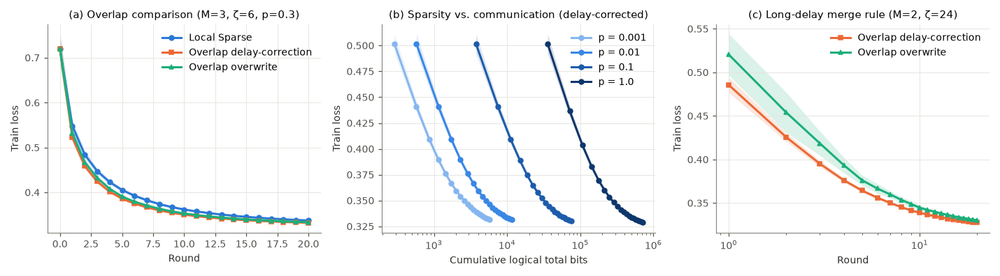

**Fig. 2, training accuracy**
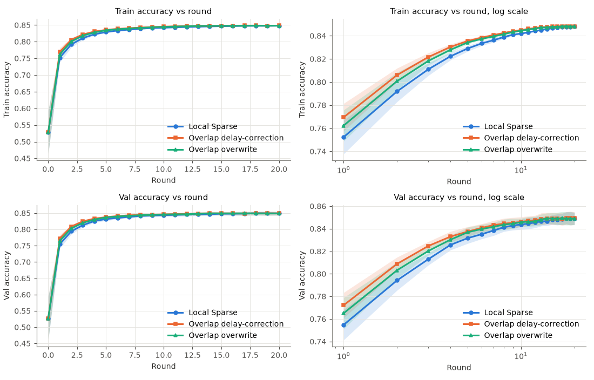

**Fig. 3, gradient norm**
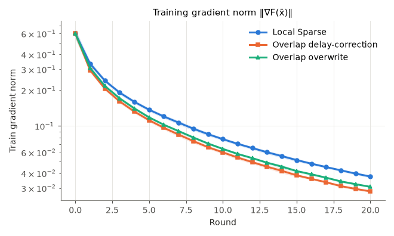

**Fig. 4, loss vs time and bits**
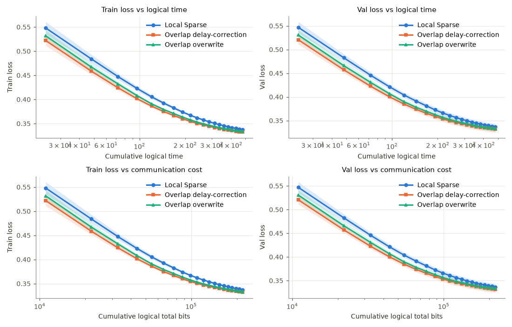

**Figs. 5–7, merge rule in three regimes**
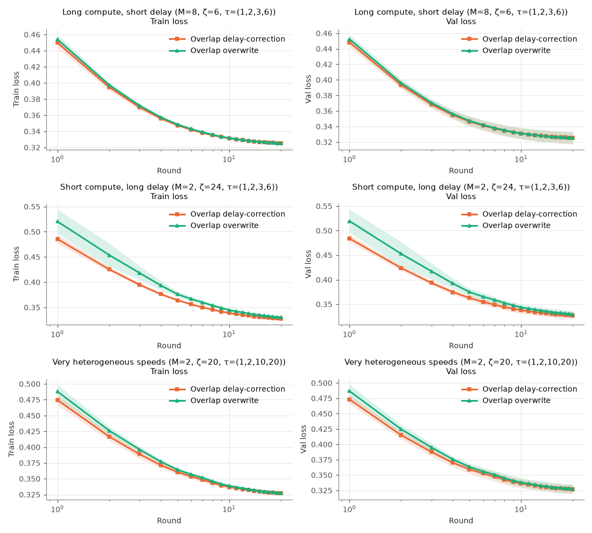

**Fig. 8, sparsity**
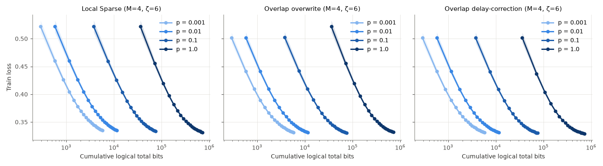

**Fig. 9, local budget M**
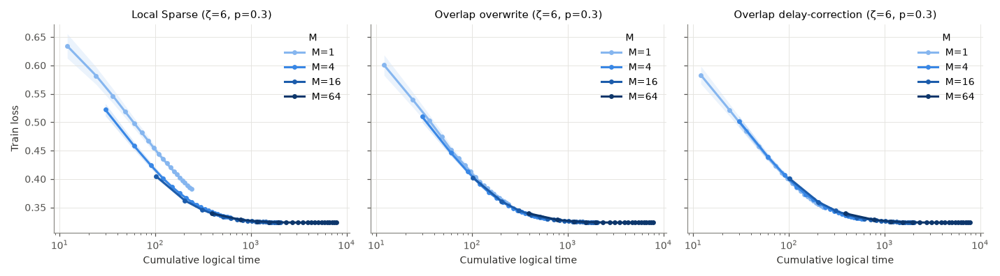

**Fig. 10, communication delay**
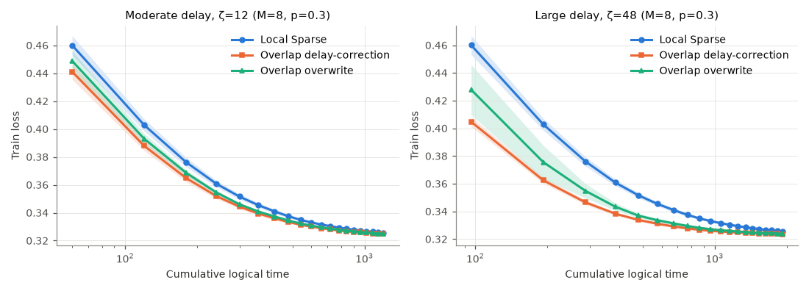

**Fig. 11, non-IID stress test**
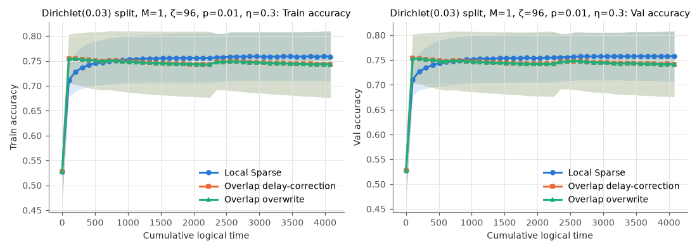

**Figs. 12–13, CIFAR-10 (scaled down)**
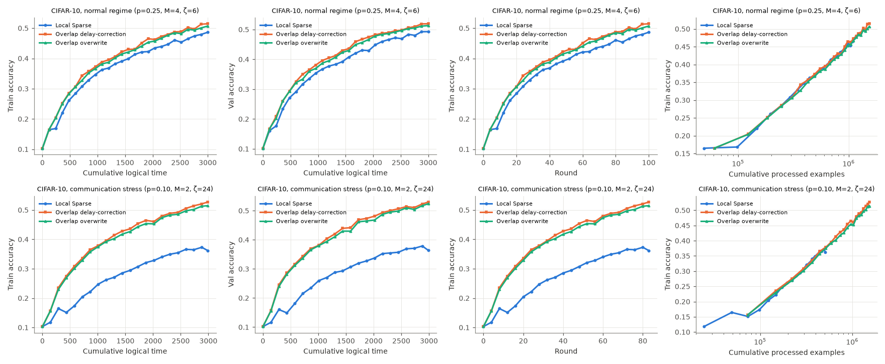

**Extra: all five methods, including Sync SGD and FedAvg-Full**
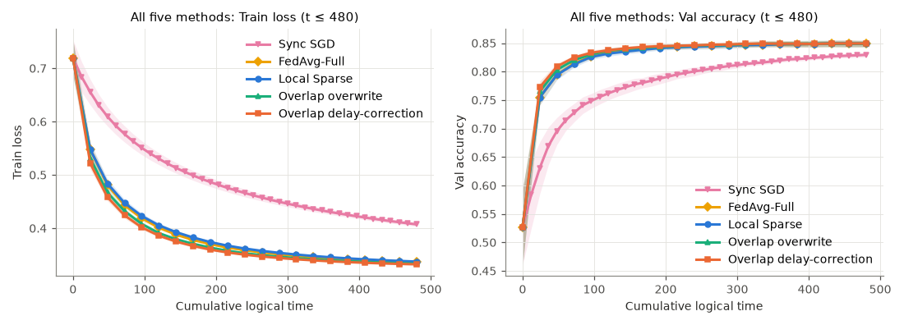

## Notes

- E6: at p=0.01 only 2 coordinates are merged per round, so OW and DC can barely differ. The data split is the likely cause; only the authors' code can settle it.
- CIFAR-10: a 58k-parameter CNN (the model is unspecified), ~1/12 of the paper's time budget (≈34 vs 400 epochs), 1 seed.
- Read off the figures: metrics at the averaged model, bits = 9·32·K, and M=8 for E5.

## Run

```bash
export LOSCAR_DATA=/path/to/data   # a9a and CIFAR-10
python experiments/run_a9a.py --seeds 10 --procs 5 && python experiments/plot_a9a.py
python experiments/run_cifar.py --budget 3000 --procs 5 && python experiments/plot_cifar.py
```

Full details: [DETAILS.md](DETAILS.md).
