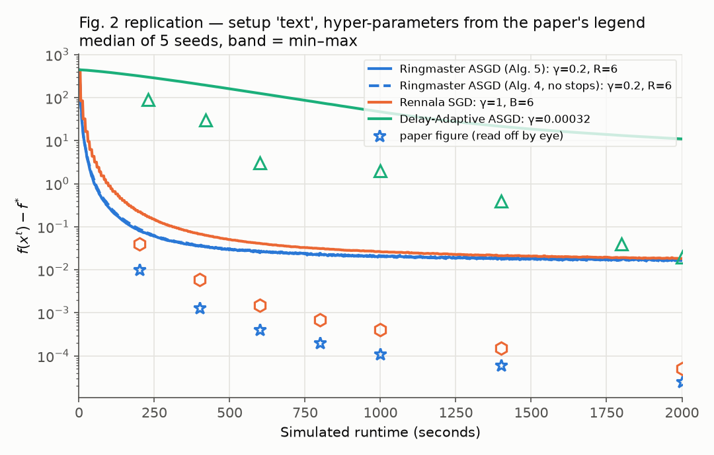
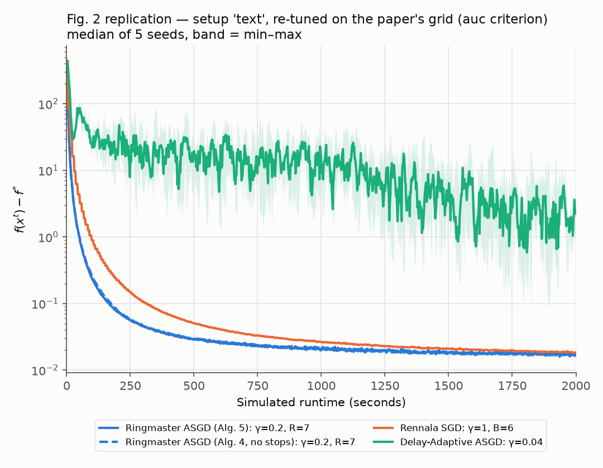
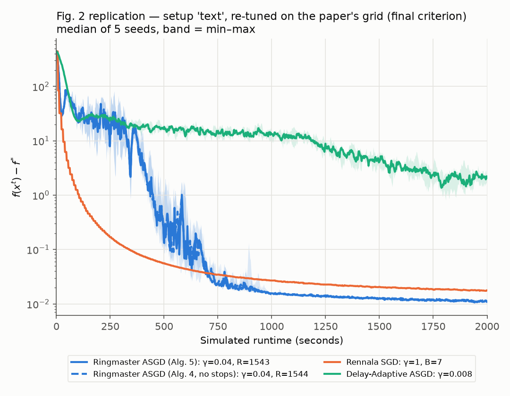
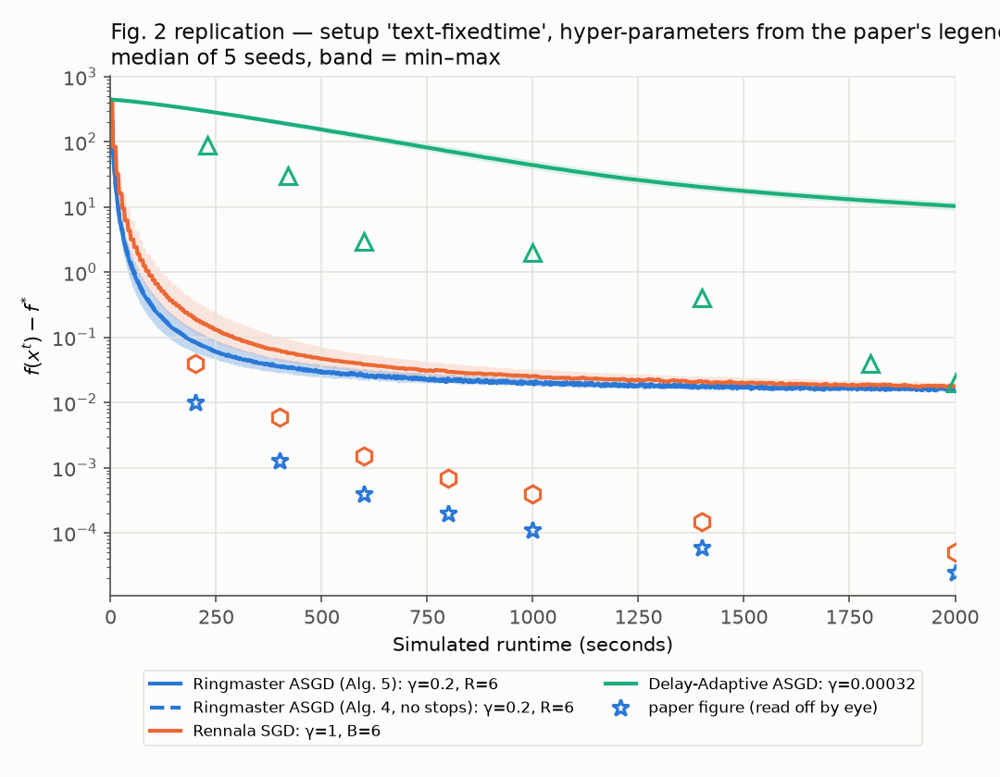
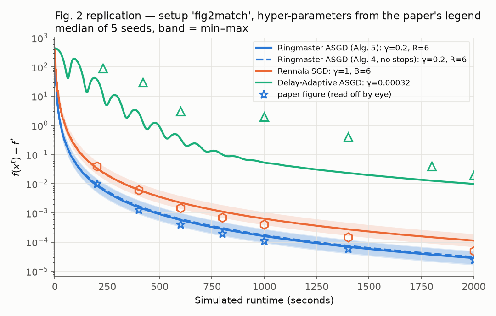
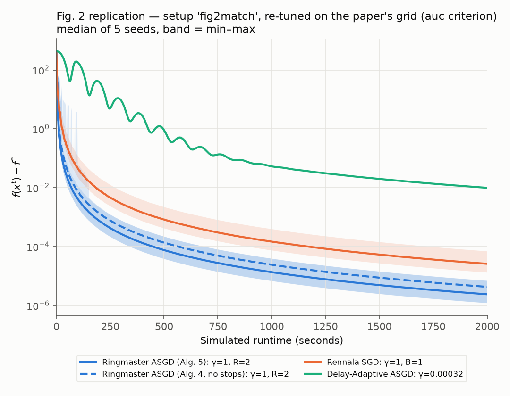
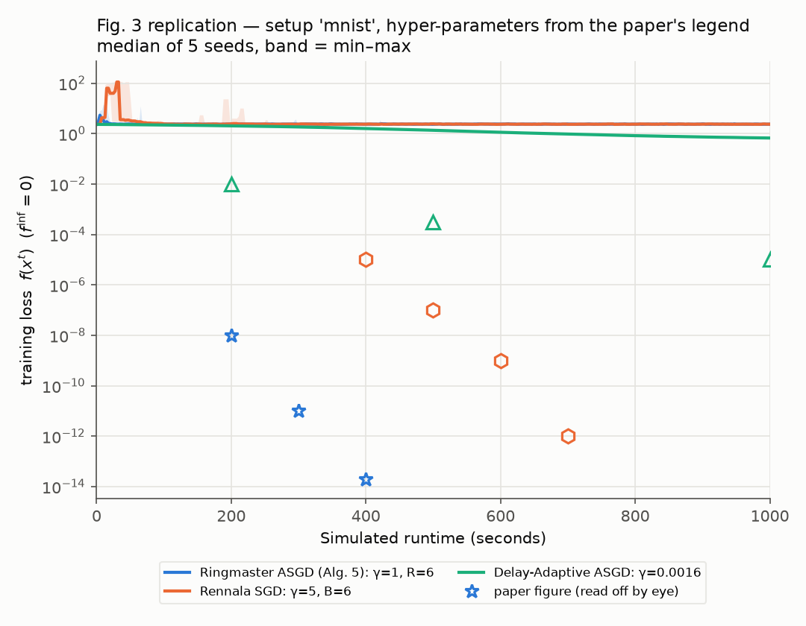
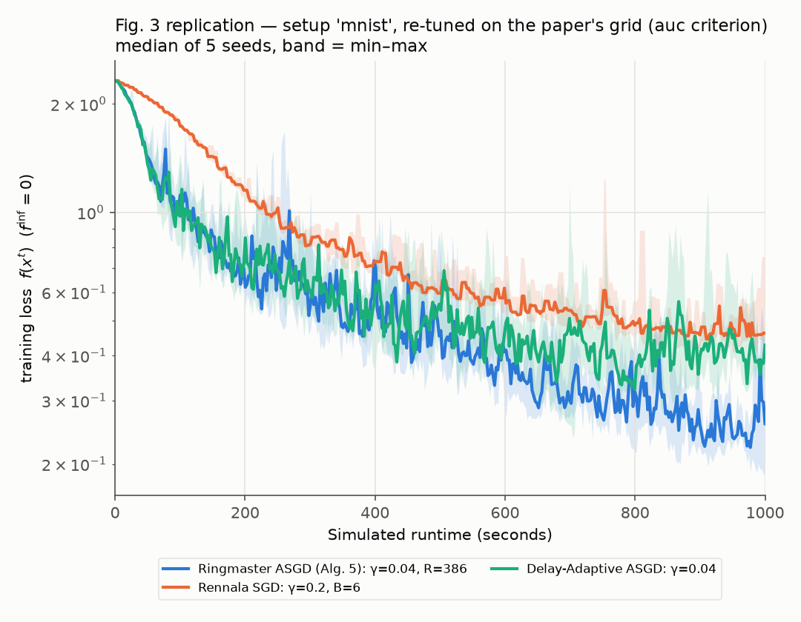

# Replication: Ringmaster ASGD

Paper: [Ringmaster ASGD: The First Asynchronous SGD with Optimal Time Complexity](https://arxiv.org/abs/2501.16168) (Maranjyan, Tyurin, Richtárik, 2025). No official code exists; this is a re-implementation as an event-driven simulation of 6174 workers.

**Verdict:** The method ranking replicates. The paper's absolute curves do not come out of the setup it describes.

## Results

| Experiment | Paper | Ours | Status | What doesn't match, and why |
|---|---|---|---|---|
| Fig. 2, quadratic: Ringmaster > Rennala ≫ Delay-Adaptive (DA) ASGD | Ringmaster fastest at all times | Same ordering at all times. Gap 0.03 reached at 474 s (Ringmaster) vs 847 s (Rennala); DA never gets below 0.1 in 2000 s | ✅ | — |
| Fig. 2 tuned hyper-parameters (Ringmaster / Rennala / DA) | γ=0.2, R=6 / γ=1, B=6 / γ=0.00032 | γ=0.2, R=7 / γ=1, B=6 / γ=0.04 | ⚠️ 2 of 3 | R=6 is not in the paper's own grid {⌈n/4ᵖ⌉}; 7 is the nearest value. DA tunes to γ=0.04 (0.008 with a final-value criterion), 25–125× the paper's 0.00032 |
| Fig. 2 gap f(x)−f* at 2000 s (Ringmaster / Rennala / DA) | 2.5e-5 / 5e-5 / 2e-2 | 1.65e-2 / 1.83e-2 / 11 | ❌ | 370–660× higher. As written, the b term keeps even noiseless gradient descent ≥ 5e-3 at this step budget, and the noise (σ² = 0.17) adds a ~1e-2 floor. DA makes only 12.7k updates in 2000 s (total step ≤ 4), too few to get below ~10. We tried 8 readings of the setup. The closest (b=0, noiseless, compute times based on √i) matches Ringmaster within 0.08 decades and Rennala within 0.13; DA stays ~1 decade off |
| Fig. 3, MNIST MLP: Ringmaster best and most robust | Training loss: Ringmaster ≈1e-14 by 400 s, Rennala ≈1e-14 by 800 s, DA 1e-5 at 1000 s | Paper's stepsizes: Ringmaster and Rennala never train (loss 2.37 = chance); DA 0.67. Re-tuned: Ringmaster 0.26 < DA 0.43 < Rennala 0.46 at 1000 s | ⚠️ Ordering only | Losses are ~13 orders of magnitude apart. The setup is unspecified (input scaling, batch, width, data size, f_inf); ours is a 784-32-10 MLP, 3000 images, batch 4. With raw 0–255 pixels we reproduce the paper's 1e6–1e7 loss spikes, but then the ReLUs die and loss freezes at 2.30. 1e-14 looks like float64 rounding on a dead network, not training. "More robust" is not supported: no method trains at γ ≥ 1 |

## Plots

Median of 5 seeds with a min–max band. Hollow markers are values read off the paper's figures.

**Fig. 2, setup as written, paper's hyper-parameters**


**Fig. 2, setup as written, re-tuned (criterion: mean log gap over the whole run)**


**Fig. 2, setup as written, re-tuned (criterion: final gap)**


**Fig. 2, fixed per-worker compute times (sensitivity check)**


**Fig. 2, variant matching the paper (b=0, noiseless, √i times), paper's hyper-parameters**


**Fig. 2, matching variant, re-tuned (whole run / final)**



**Fig. 3, MNIST, paper's stepsizes**


**Fig. 3, MNIST, re-tuned**


## Notes

- Stepsizes are tuned on the paper's grid. The criterion (unstated in the paper) is mean log gap over the run.
- x₀ = (√d, 0, …, 0), taken from the Rennala SGD paper; this paper doesn't state it.

## Run

```bash
python3 -m venv .venv && .venv/bin/pip install numpy matplotlib
.venv/bin/python run.py --setup text  --mode paper   # Fig. 2
.venv/bin/python run.py --setup text  --mode tune --criterion auc
.venv/bin/python run.py --setup mnist --mode tune --criterion auc --methods ringmaster rennala da_asgd
```

Full details: [DETAILS.md](DETAILS.md).
