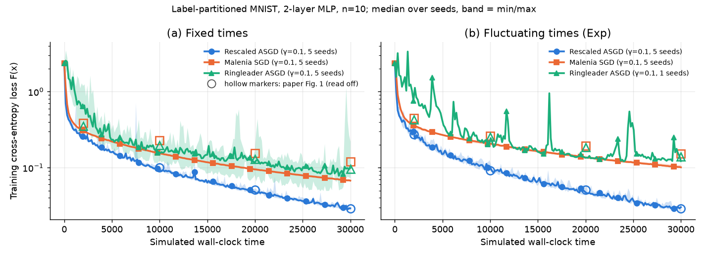
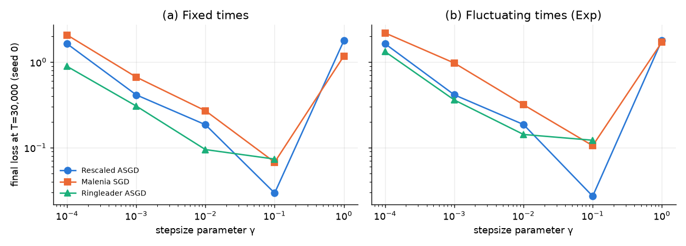
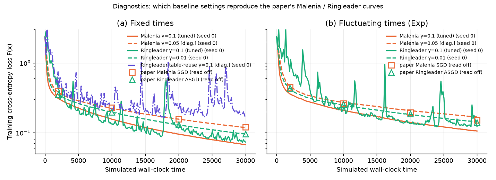
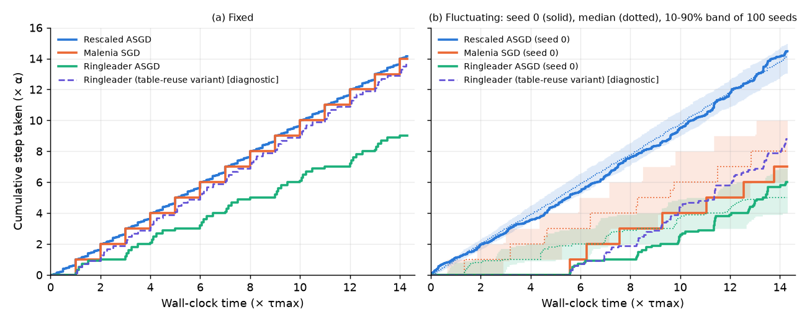
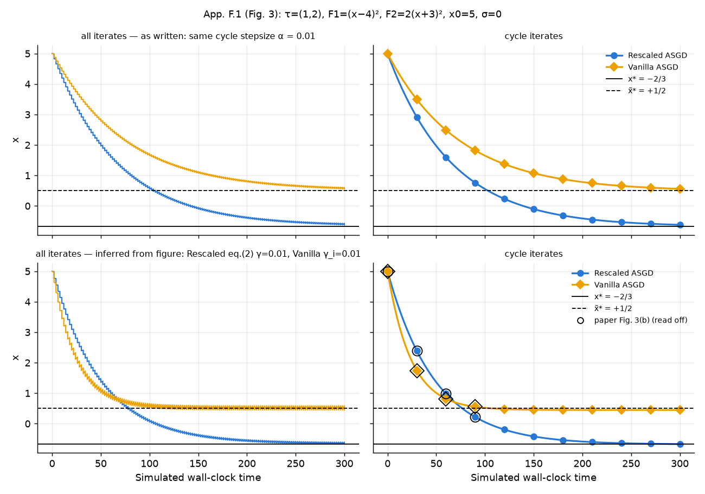
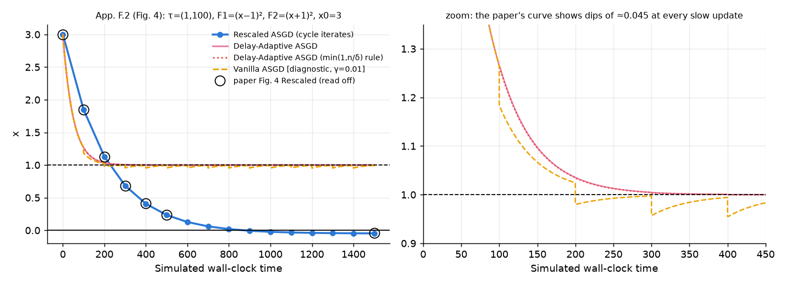

# Replication: Rescaled ASGD

Paper: [Rescaled Asynchronous SGD: Optimal Distributed Optimization under Data and System Heterogeneity](https://arxiv.org/abs/2605.13434) (Mahran, Maranjyan, Richtárik, 2026). No official code exists. All experiments were run at full scale in simulated wall-clock time, 5 seeds.

**Verdict:** The main result replicates; Rescaled ASGD matches the paper's loss exactly. Several smaller figures don't follow from the setup as written.

## Results

| Experiment | Paper (Rescaled / Malenia / Ringleader) | Ours | Status | What doesn't match, and why |
|---|---|---|---|---|
| Fig. 1a, MNIST, fixed times, final loss | 0.029 / 0.120 / 0.096 | 0.029 / 0.068 / 0.099 | ✅ | Our Malenia is 1.8× better than the paper's, so Rescaled's lead is 2.3–3.4× instead of 3–4×. The paper's Malenia curve matches ours at γ = 0.05, which is not on its stated grid |
| Fig. 1b, MNIST, random times, final loss | 0.029 / 0.152 / 0.140 | 0.030 / 0.101 / 0.122 | ✅ | Our baselines are 1.1–1.5× better than the paper's; Rescaled matches |
| Fig. 2, cumulative stepsize, fixed times | All three advance α per τ_max (Ringleader 13.7 at 14.3 τ_max) | Rescaled and Malenia match exactly. Ringleader reaches 9.0 (0.665 α per τ_max) | ⚠️ | Ringleader's Alg. 1 as published can't reach 13.7, in any processing order of simultaneous arrivals. A variant that reuses stale table entries gives exactly 13.7, but on MNIST it reaches 0.067, not the paper's 0.096. Figs. 1 and 2a seem to use different Ringleader code. The random-time panel matches |
| Fig. 3, Vanilla vs Rescaled ASGD | Vanilla → +1/2, Rescaled → −2/3; Vanilla faster at the same cycle stepsize α = 0.01 | Targets match; with equal α, Rescaled is faster | ⚠️ Targets only | The paper's curves are reproduced (to 2 decimals) only if Vanilla used a 2.25× larger cycle stepsize (0.03 vs 0.0133). The "Vanilla is faster" statement doesn't hold as written |
| Fig. 4, Delay-Adaptive (DA) vs Rescaled | DA → ≈1, Rescaled → ≈−0.04 | 0.9995 and −0.047 | ✅ Endpoints | The paper's plotted DA curve matches plain Vanilla ASGD (γ = 0.01), not its stated γ/(1+δ) rule |

## Plots

**Fig. 1, MNIST, fixed and random compute times (5 seeds)**


**Fig. 1 stepsize tuning (seed 0)**


**Fig. 1 diagnostics: baselines at the stepsizes that match the paper's curves (single seed)**


**Fig. 2, cumulative stepsize over time**


**Fig. 3, Vanilla vs Rescaled ASGD on the toy problem**


**Fig. 4, Delay-Adaptive vs Rescaled ASGD on the toy problem**


## Notes

- The headline comparison uses our tuned γ = 0.1 for all methods.
- Assumptions: worker i holds digit i, PyTorch default init, γ tuned on seed 0 by final loss.

## Run

```bash
python run_toy.py                                            # Figs. 2-4
python run_mnist.py --procs 4 --methods rescaled,malenia,ringleader   # Fig. 1
python plot.py
```

Full details: [DETAILS.md](DETAILS.md).
