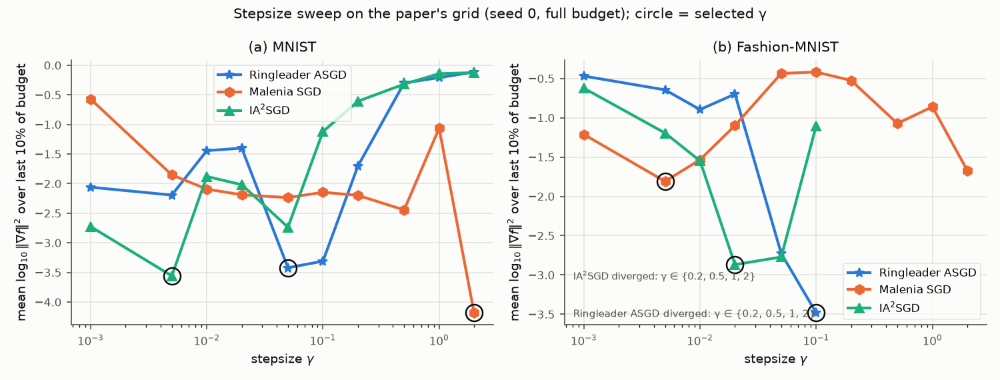
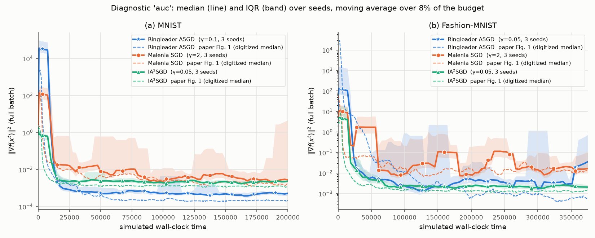
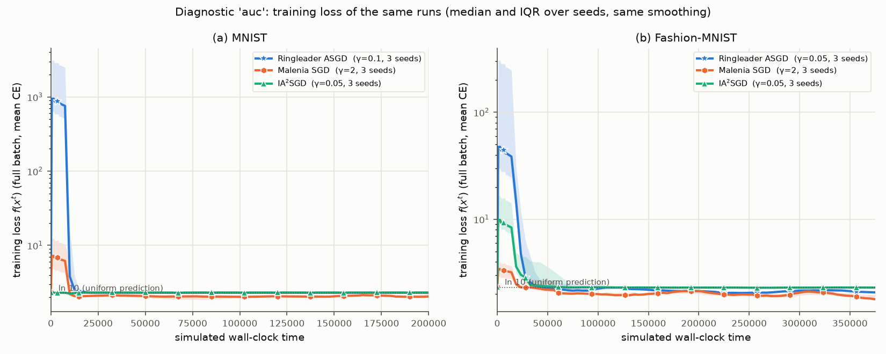
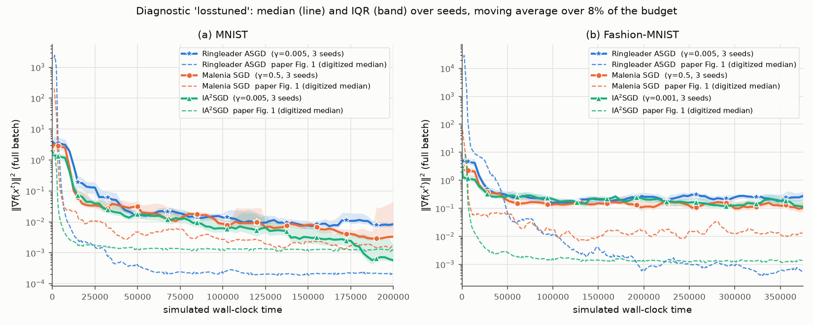

# Replication: Ringleader ASGD

Paper: [Ringleader ASGD: The First Asynchronous SGD with Optimal Time Complexity under Data Heterogeneity](https://proceedings.iclr.cc/paper_files/paper/2026/hash/08d70284b013c03ba89cd2b642bc864b-Abstract-Conference.html) (Maranjyan, Richtárik, ICLR 2026). No official code exists. The paper's only experiment (Fig. 1) was run at full scale: 100 clients, Dirichlet(0.1) labels, 784-128-10 MLP, 5 seeds.

**Verdict:** Ringleader wins on the paper's metric, the squared gradient norm ‖∇f‖². On training loss it does not: the winning stepsizes collapse the network.

## Results

| Experiment | Paper (Ringleader / Malenia / IA²SGD) | Ours | Status |
|---|---|---|---|
| Fig. 1a, MNIST, ‖∇f‖² | 2.1e-4 / 1.6e-3 / 1.2e-3 | 5.1e-4 / 3.2e-3 / 2.5e-3, same ordering | ✅ Replicated (metric) |
| Fig. 1b, Fashion-MNIST, ‖∇f‖² | 5.9e-4 / 1.3e-2 / 1.4e-3 | 4.4e-4 / 1.5e-2 / 2.9e-3, same ordering | ✅ Replicated, but sensitive to the tuning rule |
| Does Ringleader actually train better? | Not reported | No. At the winning stepsizes Ringleader collapses: loss ≈ ln 10, chance-level accuracy, 80% dead ReLUs on MNIST. Tuned on training loss, it is the slowest: MNIST 0.032 / 0.020 / 0.005, FMNIST 0.23 / 0.20 / 0.15 | ❌ Not supported |

## Plots

Dashed lines are the paper's medians, digitized from its Fig. 1. Bands are the IQR over seeds.

**Fig. 1 replication, ‖∇f‖² (γ tuned on tail ‖∇f‖², 5 seeds)**


**Same runs, training loss: Ringleader collapses to ln 10**


**Stepsize sweep on the paper's grid**


**γ chosen by mean log ‖∇f‖² over the whole run: ‖∇f‖², then loss (3 seeds)**



**γ tuned on training loss: ‖∇f‖², then loss (3 seeds)**



## Notes

- A small ‖∇f‖² here mostly means a dead network. The paper reports no loss or accuracy, so we can't tell whether its runs collapsed too; its early spikes suggest they might have.
- When stepsizes are chosen by mean log ‖∇f‖² over the whole run, IA²SGD ends lowest on FMNIST.
- Assumptions: per-gradient time jitter, PyTorch default init, γ tuned on 1 seed, budgets read off the figure axes.

## Run

```bash
export RL_DATA=/path/to/data   # MNIST gz files; Fashion-MNIST in $RL_DATA/fashion-mnist
python run.py tune  --dataset mnist fmnist
python run.py final --dataset mnist fmnist --seeds 5
python run.py final --dataset mnist fmnist --seeds 3 --tag losstuned --criterion loss
python run.py plot
```

Full details: [DETAILS.md](DETAILS.md).
